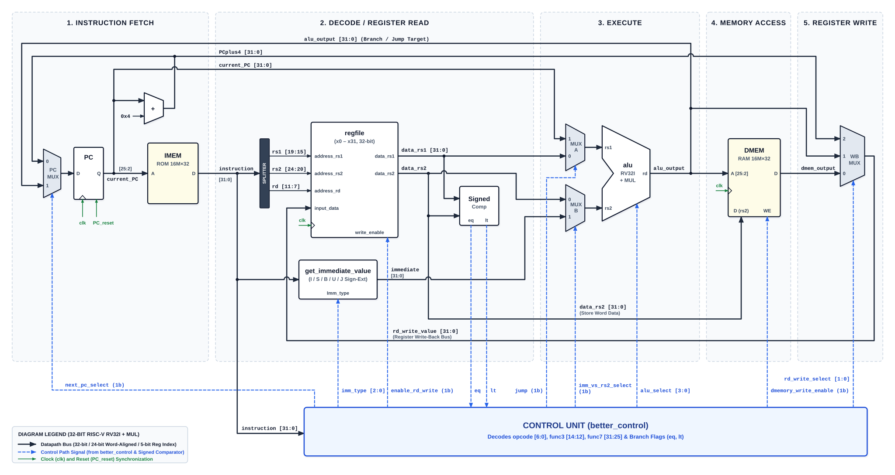

# Design and Simulation of a 32-Bit RISC-V CPU

A single-cycle 32-bit RISC-V processor (RV32I + MUL) implemented in Logisim Evolution,
with matrix-multiplication support and five verified test programs.

**Course:** Computer Architecture for AI / Hardware Architecture for Deep Learning (2026)



---

### CPU Circuit
**`risc_v_cpu.circ`** — The complete Logisim Evolution circuit. Implements a single-cycle
Harvard-architecture CPU with a 32-bit datapath, 32-register file (x0 hardwired to zero),
ALU supporting all required RV32I operations plus MUL, combinational control unit, immediate
generator, and separate instruction (ROM) and data (RAM) memories. Open this file in
Logisim Evolution to inspect or simulate the design.

### Datapath Diagram
**`riscv-datapath.svg`** — Block diagram showing the full datapath: PC, instruction register,
immediate generator, register file, ALU, data memory, and the control signals that connect them.

### ISA Documentation
**`RISC_V_CPU_ISA_Specifications.md`** — Documents the implemented instruction set:
- Reference ISA table with opcode, funct3, funct7, RTL operation, and all control signal values
  for all 21 instructions (RV32I subset + MUL)
- Register file architecture and register usage conventions
- Immediate encoding formats (I, S, B, U, J) and how the `get_immediate_value` subcircuit
  handles each
- Memory organisation: byte addressing, word alignment, and DMEM layout for the matrix
  multiplication programs

### Machine Code Encoding
**`RISC_V_CPU_matrix_multiplication_Machine_Code_Encoding.md`** — Shows how the 2×2 matrix
multiplication assembly program is encoded into 32-bit machine words. Covers all five
instruction formats, gives bit-field breakdowns for every instruction including the branch
offsets and jump offsets, and includes a complete summary table with offset verification.

### Test Programs
**`test_programs/`** — Assembly source and memory images for all five programs. Each folder
contains:

| File | Description |
|------|-------------|
| `<name>.s` | Assembly source with register allocation, per-instruction comments, and the assembler-generated disassembly appended at the end |
| `imem.hex` | Instruction memory image (Logisim `v2.0 raw` format) |
| `dmem_initial.hex` | Data memory state to load before running the program |
| `dmem_expected.hex` | Expected data memory state after the program halts |

Programs included:

| Folder | Description |
|--------|-------------|
| `matrix_multiplication_2x2` | 2×2 matrix multiply C = A × B using nested loops and MUL |
| `matrix_multiplication_3x3` | 3×3 matrix multiply (same structure, wider matrices) |
| `sum_of_1_to_N_numbers` | Sum 1 + 2 + … + N using a loop and conditional branch |
| `maximum_of_an_array` | Finds the maximum in a 5-element array using BGE comparison |
| `N_factorial` | Computes N! iteratively using MUL |

### Simulation Results
**`outputs/verification_report.md`** — Records the outcome of running each program through
Logisim Evolution v5.0.0 from the command line. All five programs produced the correct
output and halted cleanly.

| Program | Expected | Actual |
|---------|----------|--------|
| 2×2 Matrix Multiplication | C = [[19, 22], [43, 50]] | `00000013 00000016 0000002b 00000032` |
| 3×3 Matrix Multiplication | C = [[30,24,18],[84,69,54],[138,114,90]] | `1e 18 12 54 45 36 8a 72 5a` |
| Sum of 1 to N (N=10) | 55 | `00000037` |
| Maximum of Array | 27 | `0000001b` |
| N Factorial (N=6) | 720 | `000002d0` |

---

## How to Simulate and Run Programs from the Command Line

This section covers running the circuit headlessly using Logisim Evolution's CLI.
It is mainly useful for loading different programs or input data and checking the
output without opening the GUI. If you just want to look at the circuit or step
through execution manually, open `risc_v_cpu.circ` directly in Logisim Evolution.

### Prerequisites

- **Java 17 or later** — tested with Java 24.0.2. Run `java -version` to check.
- **Logisim Evolution v5.0.0** JAR, downloadable from:
  ```
  https://github.com/logisim-evolution/logisim-evolution/releases/download/v5.0.0/logisim-evolution-5.0.0-all.jar
  ```
  The commands below write `logisim-evolution.jar`; substitute the actual path.

### Running a test

```bash
java -jar "/path/to/logisim-evolution.jar" \
  --tty halt \
  -l "test_programs/<program>/imem.hex" imem \
  -l "test_programs/<program>/dmem_initial.hex" dmem \
  --save "outputs/<program>/dmem_final.hex" \
  risc_v_cpu.circ
```

`-l <file> imem` loads the hex image into the ROM labelled `imem`;
`-l <file> dmem` does the same for the RAM (`dmem`);
`--save` writes the RAM contents to a file after halting;
`--tty halt` runs headlessly and stops when the halt pin fires.

#### Example — 2×2 Matrix Multiplication

```bash
java -jar logisim-evolution.jar \
  --tty halt \
  -l test_programs/matrix_multiplication_2x2/imem.hex imem \
  -l test_programs/matrix_multiplication_2x2/dmem_initial.hex dmem \
  --save outputs/matrix_multiplication_2x2/dmem_final.hex \
  risc_v_cpu.circ
```

Logisim prints `[main] ERROR … halted due to halt pin` and exits with code 0 — this
is the normal termination message, not an actual error. Inspect the first 12 words
of `dmem_final.hex`; words 8–11 should be `00000013 00000016 0000002b 00000032`
(= 19, 22, 43, 50).

### Input memory layouts

All memory files use **`v2.0 raw`** format. The DMEM is word-indexed internally;
word `n` corresponds to byte address `n × 4`.

#### 2×2 Matrix Multiplication

| DMEM word | Byte address | Content |
|:---------:|:------------:|---------|
| 0–3 | `0x00`–`0x0C` | Matrix A row-major: A[0][0], A[0][1], A[1][0], A[1][1] |
| 4–7 | `0x10`–`0x1C` | Matrix B row-major: B[0][0], B[0][1], B[1][0], B[1][1] |
| 8–11 | `0x20`–`0x2C` | Output matrix C (written by the program) |

Default: A = [[1,2],[3,4]], B = [[5,6],[7,8]].

#### 3×3 Matrix Multiplication

| DMEM word | Byte address | Content |
|:---------:|:------------:|---------|
| 0–8 | `0x00`–`0x20` | Matrix A (3×3) row-major |
| 9–17 | `0x24`–`0x44` | Matrix B (3×3) row-major |
| 18–26 | `0x48`–`0x68` | Output matrix C |

Default: A = [[1..9]], B = [[9..1]].

#### Sum of 1 to N

| DMEM word | Byte address | Content |
|:---------:|:------------:|---------|
| 0 | `0x00` | Input N |
| 1 | `0x04` | Output sum |

Default: N = 10.

#### Maximum of Array

| DMEM word | Byte address | Content |
|:---------:|:------------:|---------|
| 0–4 | `0x00`–`0x10` | Array elements |
| 5 | `0x14` | Array length N |
| 6 | `0x18` | Output MAX |

Default: [12, 5, 27, 8, 19], N = 5.

#### N Factorial

| DMEM word | Byte address | Content |
|:---------:|:------------:|---------|
| 0 | `0x00` | Input N |
| 1 | `0x04` | Output N! |

Default: N = 6. The result must fit in 32 bits, so N ≤ 12.

### Custom inputs

Copy the relevant `dmem_initial.hex`, edit the input words at the addresses listed
above, and pass the modified file with `-l`. Leave `imem.hex` unchanged.

### Running a custom program

Encode the program using the ISA in `RISC_V_CPU_ISA_Specifications.md`, write the
hex words one per line with `v2.0 raw` as the first line, then load it the same way:

```bash
java -jar logisim-evolution.jar \
  --tty halt \
  -l custom_imem.hex imem \
  -l custom_dmem_initial.hex dmem \
  --save custom_dmem_final.hex \
  risc_v_cpu.circ
```

Every program must end with `JAL x0, 0` (`0000006f`). The circuit watches for this
self-loop and asserts the halt pin when it sees it, which is what stops the headless
simulation. Without that final instruction the simulation runs indefinitely.
